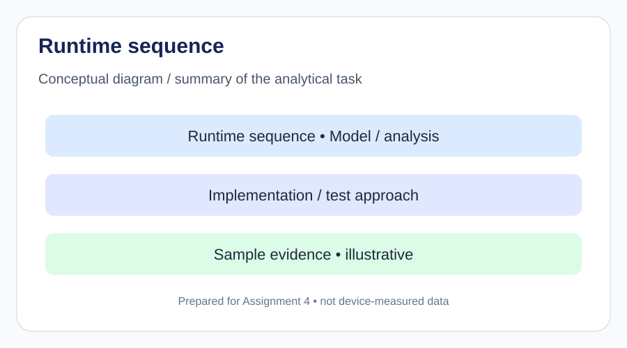

# Assignment 4A — Task 3: Runtime analysis (9 marks)

Android packages DEX and optional native libraries, loaded by Zygote-forked process and ART/ClassLoader; JIT/AOT profile strategy varies by release. iOS apps ship signed Mach-O binaries loaded by kernel/dyld, no third-party JIT. Windows packages native or .NET Native/IL components with WinRT activation.

## Android launch sequence
1. Launcher calls startActivity. 2. Binder to ActivityManagerService. 3. Component resolution/permission checks. 4. Zygote requested if process absent. 5. fork and specialize UID/SELinux/seccomp/cgroup. 6. ActivityThread and Looper attach. 7. Application/class loading/onCreate. 8. Activity lifecycle. 9. Window/view layout and frame. 10. RenderThread/GPU. 11. SurfaceFlinger presents.

Interpretation has no compile cost but slower steady-state; JIT improves hot methods with runtime CPU/memory cost; AOT pays earlier and may increase storage. Android ART mixes interpreter/JIT/profile-guided AOT. iOS ARC avoids GC pauses but retain cycles leak. Windows may use COM refcounting or managed GC. Cold starts create process/runtime/application state; warm starts reuse it. Dependency order: kernel → process → runtime → framework context → app code → UI.

## Visual evidence

