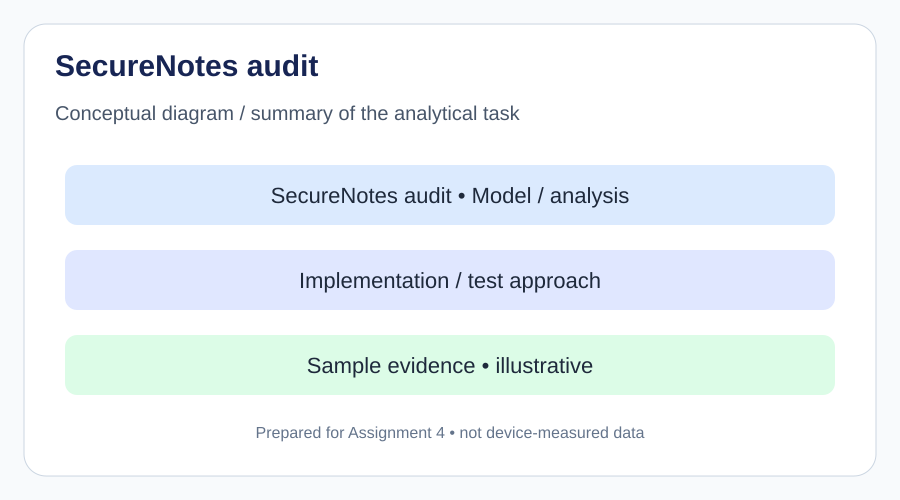

# Assignment 4A — Task 4: SecureNotes security forensics (7 marks)

## Four defects
1. Requests all permissions in advance, violating least privilege. 2. Token stored in cross-app-readable storage. 3. Updates accepted without publisher verification. 4. Cleartext network communication.

## Attack scenario
Rogue Wi-Fi reads login/token over HTTP; attacker supplies fake update metadata/package; app code runs with excessive permissions and can access/exfiltrate data. Another malicious app may read exposed token file.

## Repairs
- Declare only needed permissions; request contacts at feature-use time.
- Store token in private app storage, AES-GCM encrypted using non-exportable Keystore key.
- Install updates via platform installer and same-signature checks; verify downloaded content.
- HTTPS/TLS, cleartext disabled in Network Security Config, certificate pinning for API.

## Regression
Share-contact workflow remains after consent; token decrypts on restart using Keystore; sync succeeds with trusted server; signed updates accepted and repackaged APKs rejected.

## Visual evidence

