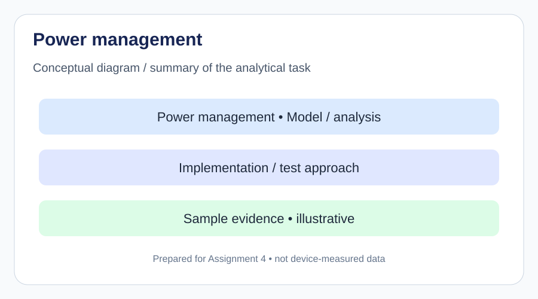

# Assignment 4A — Task 5: Power management (7 marks)

ACTIVE: screen on and interactive CPU/GPU work. IDLE: screen off, CPUs awake at lower operating points for pending work/wakelocks. SUSPENDED: CPUs off, DRAM self-refresh, wake sources armed.

Transitions: ACTIVE→IDLE on timeout/power-key; IDLE→SUSPENDED when no wakelock/work/timer; SUSPENDED→IDLE on wake IRQ; IDLE→ACTIVE on user input/call. A persistent partial wakelock prevents suspend.

Urgent push while suspended: OS-owned push connection as wake source, short callback allowance, WorkManager/JobScheduler constraints, hardware sensor batching/FIFO, wakelocks only around bounded work. Avoid permanent wakelocks, polling, persistent app sockets and repeating exact alarms.

At 15% saver: lower sampling interval, defer sync to Wi-Fi/charging, restrict background tasks, throttle location and nonessential animation; trade timely data for device longevity.

## Visual evidence

