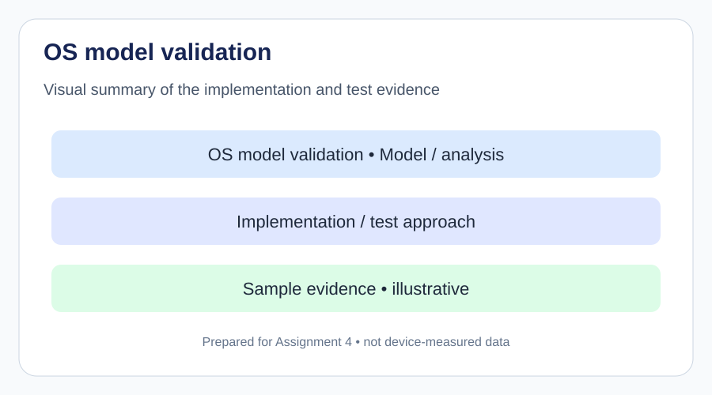

# Assignment 4B — Task 1: OS model validation (8 marks)

Validate resource-management and lifecycle assumptions for Android vs iOS. Compare observable OS mechanisms, process/background limits, memory/resource controls and application behaviour. Use the provided model/tests and capture fields for device-dependent results; do not substitute predictions for measurements.

## Implementation and evidence

- [Python implementation](./os_model_validation.py)
- [Sample output](./output.txt)
- [Run instructions](./RUN.md)

<small>Sample/model outputs are illustrative, not real device measurements.</small>
