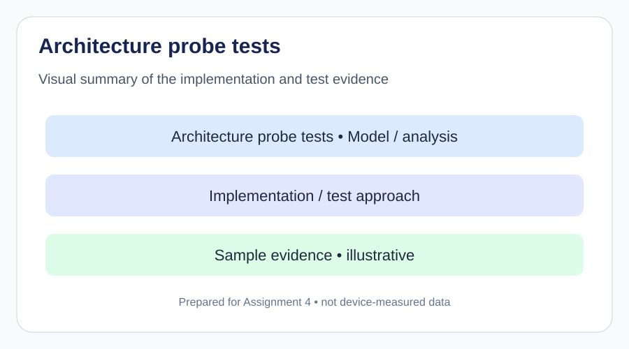

# Assignment 4B — Task 2: Architecture assumptions vs measured reality (9 marks)

Investigate threading/concurrency assumptions using build, instrument, test, break and debug workflow. Run the provided experiment on the intended environment, record timings and scheduler/thread evidence, compare against predicted behaviour and explain deviations. Device-dependent captures must come from actual runs.

## Implementation and evidence

- [Python implementation](./architecture_probe.py)
- [Sample output](./output.txt)
- [Run instructions](./RUN.md)

<small>Sample/model outputs are illustrative, not real device measurements.</small>
