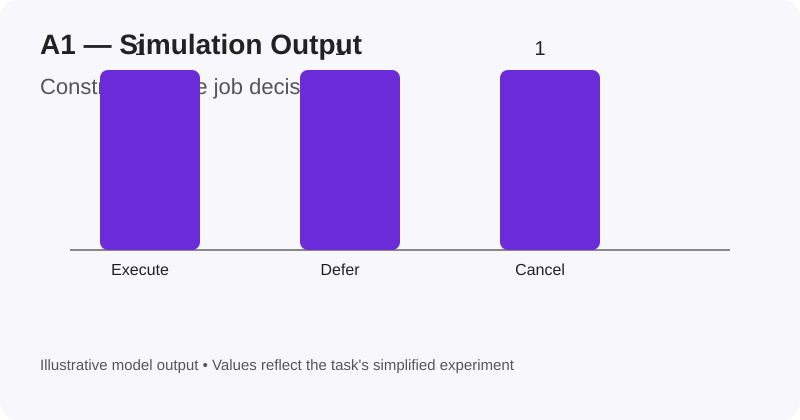

# A1 — Constraint-Aware Intent & Service Architecture
Model sensor events, network, battery, Doze, permission, encryption, user policy and durable queue. Output safe uploads/acknowledgement and critical notifications.

Persist ID/idempotency key, payload reference, sensitivity, priority/deadline, attempts/error, upload offset, constraints, state and key version.

Feasible iff queued, permission granted, sensitive payload encrypted, policy-compliant network, battery threshold (unless critical), Doze-compatible and not expired/acknowledged.

Pseudocode: create/encrypt/store record; explicit NEW_RECORD intent; route critical alert with minimal metadata. Select by priority/deadline/size. Expired/revoked: cancel/audit/cleanup. Infeasible: durable defer/backoff. Feasible: idempotent upload. ACK: mark/retention cleanup. Transient: defer. Permanent: rollback/failed.

Trace: R1 encrypted queued; Wi-Fi/battery 72% upload ACK; Doze defers R2; critical R3 notification and preserved encrypted payload; offline defers; logout/consent revocation cancels, revokes keys and cleans user data. Use explicit intents internally, ordered critical route, WorkManager for deferrable work; foreground service only when policy allows.

## Output Visualization

