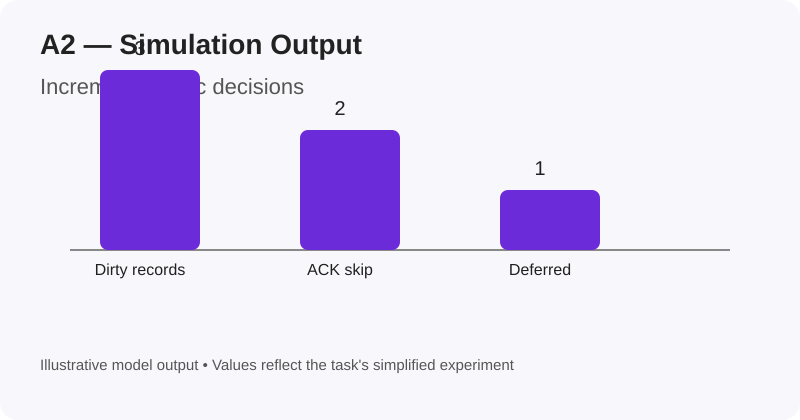

# A2 — Incremental & Constraint-Aware Synchronisation
Naïve SyncAll wastes duplicate uploads, CPU/radio wakeups, poorly prioritizes, risks consent/encryption leakage, lacks conflict policy and bounded retry.

Pseudocode: select dirty/queued ordered criticality/deadline/size. Skip remote ACK. Cancel revoked/expired. Encrypt or defer sensitive plaintext. Resolve conflict using version metadata/user policy. Check network, battery and metered-size limits. Upload idempotently; ACK, defer transient or quarantine permanent.

|ID|Priority|Size|Sensitive/encrypted|Environment|Decision|
|R1|5|80 KB|Yes/Yes|Wi-Fi 80%|Upload|
|R2|2|800 KB|No|Metered 18%|Defer|
|R3|4|180 KB|Yes/Yes|Wi-Fi 80%|Upload|
|R4|1|50 KB|No|Wi-Fi 80%|Upload if budget|
|R5|5|600 KB|Yes/No|Wi-Fi 80%|Encrypt or quarantine|

Offline-first retains local progress using operation logs, causal/version metadata and conflict policy; offline is a defer for sync, not a block on local writes.

## Output Visualization

