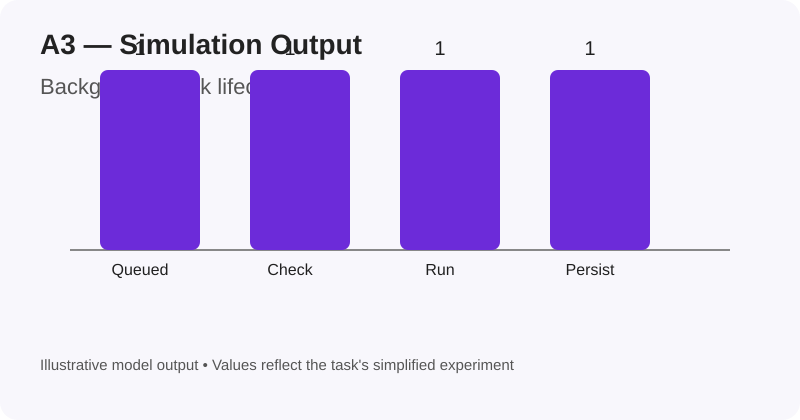

# A3 — Generic Mobile Background-Work Pattern
|Component|Sensors|Sync|Push|
|---|---|---|---|
|State|Permission, schedule, queue|Dirty/version/retries/ACK|Token, payload, deadline|
|Decision|Sample/defer/stop|Upload/defer/resolve|Send/schedule/retry|
|Feasibility|Permission, battery, Doze|Network, encryption, consent|Token, permission, deadline|
|Goal|Required samples|Durable convergence|Alert within SLA|
|Undo|Stop listener|Rollback partial upload|Cancel/dedupe notification|

Generic pattern: select ready item; observe platform; check constraints; cancel with compensation or defer/backoff and persist; mark running; idempotently execute; commit ACK and cleanup on success; compensate and retry/fail otherwise. Undo must release leases, securely remove temporary plaintext, abort/resume partial transfer, dedupe notification and clean revoked user data.

## Output Visualization

