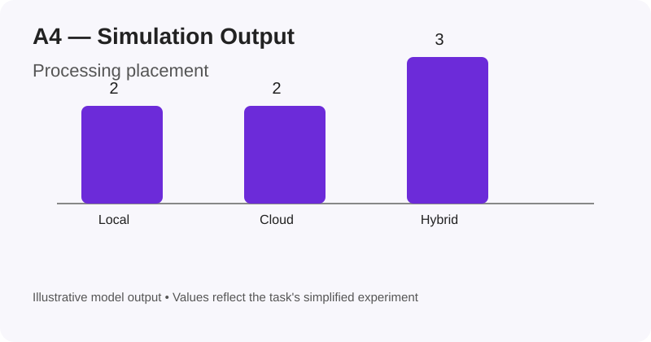

# A4 — Local vs Cloud vs Hybrid Processing
|Problem|Approach|Verification|Class/reason|
|---|---|---|---|
|Tiny image classification|Quantized local model|Fixed set, confusion matrix, latency/energy|Local, battery/thermal constraints|
|Speech recognition|Cloud transcript, local fallback|WER/CER, latency percentiles, loss|Hybrid, network-bound|
|P2P sharing|Authenticated complete transfer|Hash, provenance, interruption/resume|Security/radio critical|
|E2E messaging|Endpoint decryption|Crypto vectors, key rotation, replay|Security critical|
|Multiplayer sync|Convergent state|Determinism, lag/jitter/divergence|Hybrid, network-bound|
|Offline maps|Cache and render locally|Golden images, tile boundary, frame-time|Local bounded area; hybrid scale|

Define mobile performance by operation, workload/device, resource budget, percentile and target. Dimensions include latency, throughput, tail behaviour, energy, memory and correctness/security. Offloading moves bottlenecks and trust boundaries.

## Output Visualization

