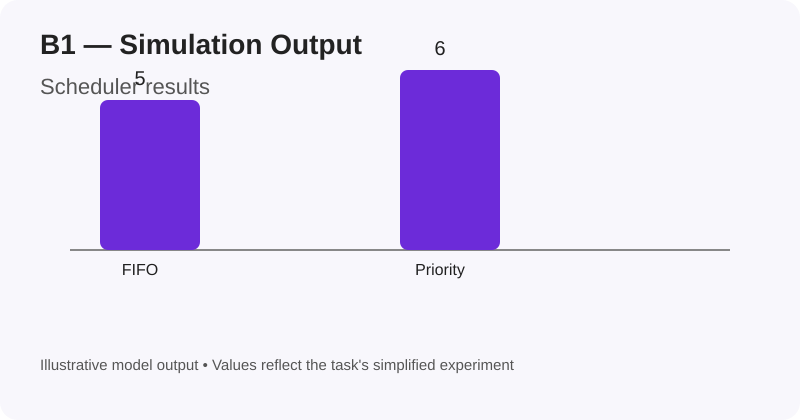

# B1 — Instrumented Background Architecture

## Aim
Instrument a simulated background-work pipeline and compare FIFO and priority scheduling.

## Model
Five queued records. Good environment permits work. Harsh environment includes low battery, Doze and unavailable network. Deferred records remain queued; deferral is not failure.

## Sample results
|Environment|Scheduler|Enqueued|Deferred|Successful|Backlog|
|---|---|---:|---:|---:|---:|
|Good|FIFO|5|0|5|0|
|Good|Priority|5|0|5|0|
|Harsh|FIFO|5|8|0|5|
|Harsh|Priority|5|7|1|4|

Run `python b1.py`; CSV output is generated. These values are illustrative scenario results, not physical device measurements.

## Output Visualization

